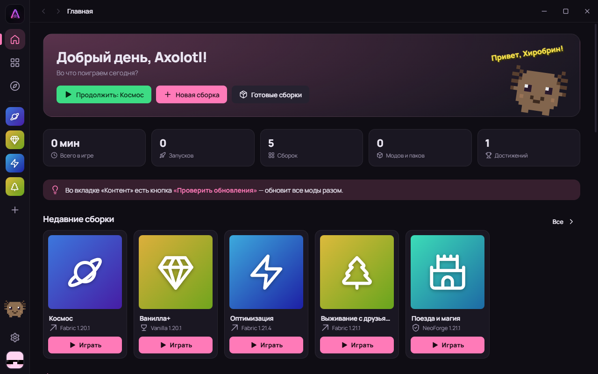
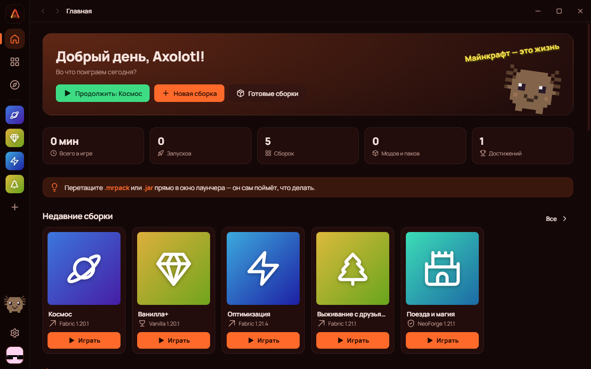
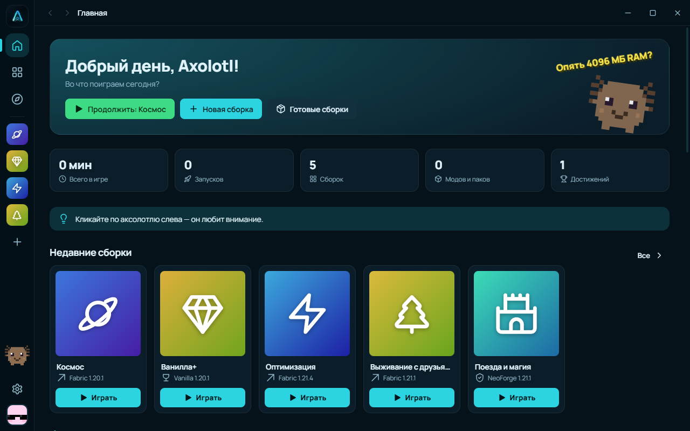

<p align="center">
  
</p>

<h1 align="center">Axolaunch</h1>

<p align="center">
  Лаунчер Minecraft с модами без головной боли · <a href="#english">English</a><br>
  <a href="https://keysliong.github.io/axolaunch/"><b>Сайт</b></a> ·
  <a href="https://github.com/keysliong/axolaunch/releases/latest"><b>Скачать для Windows</b></a>
</p>

<p align="center">
  
</p>

## Что умеет

- **Modrinth и CurseForge в одном каталоге**: моды, сборки, ресурспаки, шейдеры и датапаки. Фильтры по загрузчику, версии, категориям и окружению. Обязательные зависимости ставятся сами.
- **Доктор сборки**: если игра вылетела, лаунчер читает лог и crash-report и находит виновный мод. С твоего разрешения он доставит недостающий мод, обновит неподходящий или отключит лишний. Ещё он умеет поправить Java и память.
- **Все версии Minecraft**: релизы, снапшоты, beta и alpha.
- **Все загрузчики**: Vanilla, Fabric, Quilt, Forge, NeoForge.
- **Java ставится сама**: Eclipse Temurin 8, 17, 21 или 25, в зависимости от версии игры.
- **Сборки .mrpack**: установка с Modrinth в один клик, импорт перетаскиванием и экспорт с выбором файлов.
- **Управление контентом**: включение и выключение модов, проверка обновлений и «Обновить всё», добавление файлов перетаскиванием.
- **Настройки сборки**: своя Java, память, аргументы JVM, размер окна, переменные окружения, хуки, группы, смена версии и загрузчика.
- **Быстрые загрузки**: десятки потоков, проверка хешей, повтор при обрыве, любую загрузку можно отменить.
- **Аккаунты Microsoft**: токены шифруются через системное хранилище.
- **Логи в реальном времени**: фильтр, подсветка ошибок, учёт игрового времени.
- **Языки**: русский и английский.

## Кастомизация

- 10 тем: Аксолотль, Modrinth, OLED, Светлая, Незер, Энд, Океан, Лес, Вишня, Ретро-терминал. Иконка лаунчера перекрашивается под каждую тему.
- Свой акцентный цвет и шесть шрифтов.
- Фон-картинка с размытием, компактный режим.
- Поле для **своего CSS**.

<p align="center">
  
  
</p>

## Приколюхи

- 🦎 **Аксолотль-питомец** в боковой панели: моргает, прыгает и болтает. **Синего** можно встретить с шансом 1/1200, как в игре.
- 💬 **Сплэш-надписи**, как на титульном экране Minecraft.
- 🏆 **16 достижений**: «Ночная сова», «Марафонец», «Ой, всё» и другие.
- 🎮 **Конами-код** ↑↑↓↓←→←→BA.
- 👁️ Попробуй назвать сборку `Herobrine`.

## Установка

Скачай `Axolaunch Setup *.exe` (установщик) или `Axolaunch *.exe` (переносная версия) со [страницы релизов](https://github.com/keysliong/axolaunch/releases/latest).

Лаунчер пока не подписан сертификатом, поэтому Windows SmartScreen может предупредить о неизвестном приложении. Нажми «Подробнее» → «Выполнить в любом случае».

CurseForge работает только с личным API-ключом. Он бесплатный: возьми его на [console.curseforge.com](https://console.curseforge.com/) и вставь в лаунчер при первом выборе CurseForge.

## Сборка из исходников

```powershell
npm install
npm start        # запуск в режиме разработки
npm run dist     # установщик и переносная версия в dist/
npm run icon     # пересоздать иконку из assets/logo.svg
```

## Где лежат данные

`%APPDATA%\Axolaunch`. Внутри:
- `instances` — сборки;
- `meta` — общие файлы игры;
- `java` — скачанная Java;
- файлы настроек.

## Структура

```
src/main/       — процесс Electron: установка, запуск, Modrinth, CurseForge, .mrpack, доктор сборки, аккаунты
src/renderer/   — интерфейс (ES-модули без сборщика)
docs/           — сайт (GitHub Pages)
build/          — скрипты иконки
assets/         — иконки приложения
```

---

## English

**Axolaunch** is a free, open-source Minecraft launcher for Windows. [Website](https://keysliong.github.io/axolaunch/) · [Download](https://github.com/keysliong/axolaunch/releases/latest)

- Mods, modpacks, resource packs, shaders and datapacks from **Modrinth and CurseForge**. Dependencies install automatically.
- **Instance doctor**: when the game crashes, it reads the log, finds the broken mod and offers to fix it with your permission.
- Every Minecraft version. Vanilla, Fabric, Quilt, Forge and NeoForge. Java is installed automatically.
- `.mrpack` import and export, update checks, per-instance settings.
- 10 themes, custom accent color, fonts, background and CSS. Plus an axolotl pet.
- Russian and English interface.

CurseForge requires a free personal API key from [console.curseforge.com](https://console.curseforge.com/).

---

Axolaunch is not an official Minecraft product and is not approved by or associated with Mojang or Microsoft. Released under the [MIT license](LICENSE).
